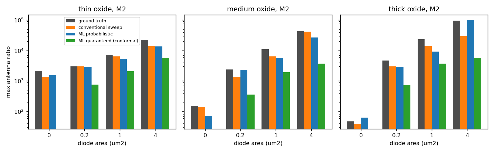
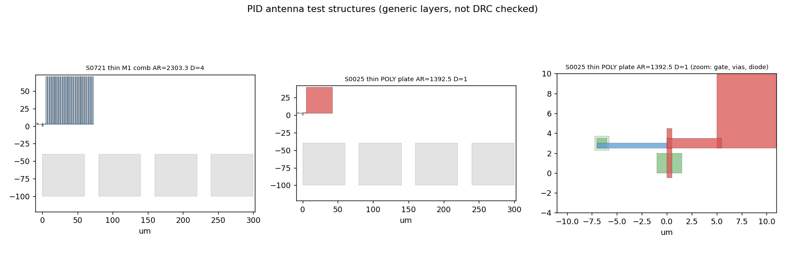
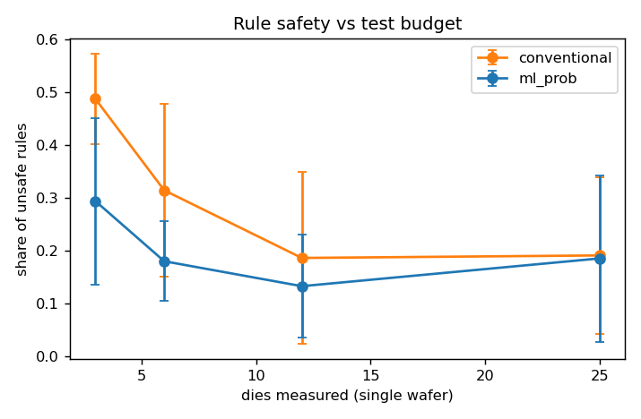

# pid-antenna-rules-ml

**Extraction de règles d'antenne robustes contre le Plasma Induced Damage (PID), assistée par apprentissage automatique.**

> Projet personnel réalisé en octobre 2026 en préparation de ma candidature à la thèse CIFRE STMicroelectronics (Crolles) *« Analyse de données de PID et élaboration de règles de conception robustes assistées par IA »*.
> Les données sont **synthétiques**, produites par un modèle physique simplifié que j'ai écrit pour me former au sujet. Aucun paramètre ne provient d'une technologie réelle (P18, 28FDSOI, 3D40 ou autre).

L'objectif n'est pas de prétendre résoudre le problème de la thèse, mais de parcourir de bout en bout ses trois phases (dessin de structures de test, caractérisation électrique, analyse de données par IA) pour en comprendre la physique, les pièges statistiques et les questions ouvertes.



---

## 1. Physique modélisée (`pid/physics.py`)

Pendant une étape plasma, un conducteur flottant relié à une grille (l'**antenne**) collecte un courant de charge. En régime établi, ce courant doit s'écouler vers le substrat :

$$I_{ant} = A_{grille}\,\big(J_{FN}(V) + g_{leak}\,V\big) + A_{diode}\,G_d\,\max(V - V_{on}, 0)$$

| Mécanisme | Modèle retenu |
|---|---|
| Courant d'antenne | $I_{ant} \propto f_{couche}\,f(r)\,\big[(1-w_p)A_{ant} + w_p P_{ant}\big]$, part surfacique et part périmétrique selon la couche |
| Non-uniformité du plasma | $f(r) = 1 + 0{,}8\,(r/R)^2$, bord de plaque plus agressif |
| Injection dans l'oxyde | Fowler-Nordheim $J_{FN} = A E^2 e^{-B/E}$ (constantes SiO₂), fuite directe bénigne pour l'oxyde mince |
| Diode de protection | conductance finie au-dessus de $V_{on}$ : une grosse antenne peut saturer une petite diode |
| Dégradation | $\Delta V_t = c\,Q^{n}$ (génération de pièges, dispersion lognormale), claquage Weibull avec loi d'échelle en surface |
| Mesure | mismatch de Pelgrom $\sigma = \sqrt{2}\,A_{Vt}/\sqrt{WL}$ entre le transistor et sa référence sans antenne, bruit de mesure, variation plaque à plaque |

La tension de grille est résolue par dichotomie vectorisée (le bilan est monotone en $V$), ce qui permet de simuler 85 500 mesures en moins d'une seconde.

## 2. Structures de test (`pid/structures.py`)

* **Plan d'expériences** de 1 140 structures : un balayage classique du rapport d'antenne (AR de 30 à 30 000) sur la structure de référence (plaque, grille 1 µm²) pour chaque couple oxyde / couche / diode, complété par 420 structures tirées en log-uniforme pour explorer les interactions (forme, surface de grille, couche).
* Deux formes d'antenne pour **séparer les contributions surfacique et périmétrique** : plaque (périmètre minimal) et peigne (doigts de 0,4 µm).
* **Génération GDS** (gdstk) d'une puce de test : transistor, pile de vias jusqu'à la couche d'antenne, antenne, diode N+ optionnelle, plots de test. Carte de couches générique, non vérifiée DRC.



## 3. Campagne de caractérisation simulée (`pid/simulate.py`)

3 plaques × 25 puces × 1 140 structures. Pour chaque mesure : $\Delta V_t$ par rapport à la référence et test de fuite de grille. Critère d'échec : $|\Delta V_t| > 20$ mV ou claquage.

## 4. Extraction de règles par IA (`pid/rules.py`)

Trois stratégies, comparées à la **vérité terrain** connue grâce au simulateur (plus grand AR tel que P(échec) ≤ 5 % en bord de plaque, estimé par Monte-Carlo) :

| Méthode | Principe |
|---|---|
| **Conventionnelle** | sur le balayage d'AR, plus grand AR avant le premier échec observé |
| **ML probabiliste** | classifieur gradient boosting **contraint monotone** (croissant en AR, périmètre, rayon ; décroissant en taille de diode), recalibré par régression isotonique, règle à P(échec) ≤ 5 % |
| **ML garantie** | modèle monotone de $\Delta V_t$ dans l'espace $\operatorname{asinh}(\Delta V_t/5\,\text{mV})$, échelle de bruit apprise, **calibration conforme normalisée** sur des structures jamais vues : borne supérieure à couverture garantie |

Les contraintes de monotonie encodent la physique connue et garantissent des règles cohérentes (pas de zone « autorisé, interdit, puis autorisé à nouveau »).

> **Piège rencontré.** Ma première version utilisait la perte quantile de scikit-learn. Les valeurs des feuilles y sont réestimées après chaque arbre, ce qui **casse silencieusement la contrainte de monotonie** : la borne prédite baissait de 25,7 à 13 mV quand l'AR triplait. D'où le passage à une régression en moyenne (monotonie garantie) plus une calibration conforme.

## 5. Résultats

Séparation entraînement / calibration / test **par structure** (aucune fuite entre puces d'une même structure).

| Indicateur | Valeur |
|---|---|
| Couverture de la borne conforme sur structures de test (cible 95 %) | **95,7 %** |
| AUC du modèle d'échec | **0,980** (Brier 0,041) |
| Variables les plus importantes (permutation) | taille de diode, AR, épaisseur d'oxyde, rapport périmétrique |

**Règles sur la structure de référence, toutes données** (part de règles dangereuses = règle > 1,15 × vérité) :

| Méthode | Règles dangereuses | Médiane règle / vérité |
|---|---|---|
| Conventionnelle | 0 % | 0,65 |
| ML probabiliste | 4,2 % | 0,63 |
| ML garantie | 0 % | 0,13 |

**Budget de test réduit** (une plaque, 5 tirages par budget) :

| Puces mesurées | Conventionnelle : règles dangereuses | ML probabiliste : règles dangereuses |
|---|---|---|
| 3 | 49 % | **29 %** |
| 6 | 32 % | **18 %** |
| 12 | 19 % | **13 %** |
| 25 | 19 % | 19 % |



**Structures jamais balayées** (la méthode conventionnelle ne peut rien produire) :

| Structure | ML probabiliste dangereuses | ML garantie dangereuses | ML garantie médiane / vérité |
|---|---|---|---|
| Peigne, grille 1 µm² | 6,6 % | 0 % | 0,08 |
| Plaque, grille 4 µm² | 16,9 % | 1,4 % | 0,29 |

## 6. Ce que j'en retiens

1. **Le gain de l'IA n'est pas là où on l'attend.** Avec beaucoup de données sur la structure balayée, le modèle ne fait pas mieux que la méthode classique. Il apporte en revanche (a) une meilleure robustesse quand le budget de test est faible, en mutualisant l'information entre structures, et (b) la capacité de proposer une règle pour des géométries non caractérisées.
2. **Robustesse et coût sont en tension.** La borne conforme ne produit aucune règle dangereuse mais divise l'AR autorisé par 3 à 10, ce qui coûterait cher en surface de diodes. Une calibration conditionnelle (par oxyde, par couche) ou un critère de risque adapté à l'usage est une vraie question de recherche.
3. **L'extrapolation en surface de grille est le point faible** (16,9 % de règles dangereuses à 4 µm²) : le claquage suit une loi d'échelle en surface que le modèle n'apprend pas bien hors du domaine. Une piste est d'injecter cette loi physique dans le modèle plutôt que de l'apprendre.
4. **Constat de dessin de structures.** Sur une grille de 0,2 µm², le mismatch de Pelgrom seul donne σ ≈ 9,5 mV sur $\Delta V_t$ : un critère de 20 mV fait échouer environ 4 % des transistors **non endommagés**. La règle devient alors indépendante de la diode, donc dénuée de sens. La surface de grille d'une structure de test doit être dimensionnée pour que le mismatch reste très inférieur à la spécification, ou il faut moyenner plusieurs références.

## 7. Limites

* Données et paramètres synthétiques, choisis pour reproduire des tendances qualitatives connues, pas des valeurs réelles.
* Modèle physique volontairement simplifié : pas de modèle de gaine plasma, pas d'effet de charge positive vs négative, pas de recuit post-process, pas de topologie réelle d'interconnexion (distance diode / grille, sauts de couche).
* Layouts démonstratifs, non vérifiés DRC.

## 8. Pistes pour la thèse

* **Plan d'expériences actif** : choisir les prochaines structures à dessiner là où l'incertitude sur la frontière de règle est la plus forte.
* **Modèles hiérarchiques bayésiens** (lot / plaque / puce) pour séparer la variabilité du procédé de celle des structures.
* **Modèles hybrides physique / données** : garder Fowler-Nordheim et les lois d'échelle de claquage, n'apprendre que les écarts.
* Transfert de règles entre plateformes (P18, 28FDSOI, 3D40) via des variables physiques communes (épaisseur d'oxyde, intensité de charge par étape).

## Reproduire

```bash
pip install -r requirements.txt
make all        # DOE + GDS, campagne simulée, extraction de règles, figures
make test
```

Durée totale : environ 2 minutes sur CPU.

## Structure

```
pid/physics.py       modèle physique simplifié du PID
pid/structures.py    plan d'expériences et génération GDS
pid/simulate.py      campagne de caractérisation simulée
pid/rules.py         modèles monotones, calibration conforme, extraction de règles
scripts/             pipeline en 4 étapes
tests/               tests unitaires (monotonie, bilan de courant, extraction)
results/             métriques, règles extraites, figures
layout/              puce de test GDS
```

## Références

* Fang & McVittie, *Thin-oxide damage from gate charging during plasma processing*, IEEE EDL, 1992.
* Krishnan et al., *Antenna protection strategy for ultra-thin gate MOSFETs*, IEDM, 1998.
* Pelgrom et al., *Matching properties of MOS transistors*, IEEE JSSC, 1989.
* Lei et al., *Distribution-free predictive inference for regression*, JASA, 2018.
* Romano, Patterson & Candès, *Conformalized quantile regression*, NeurIPS, 2019.
